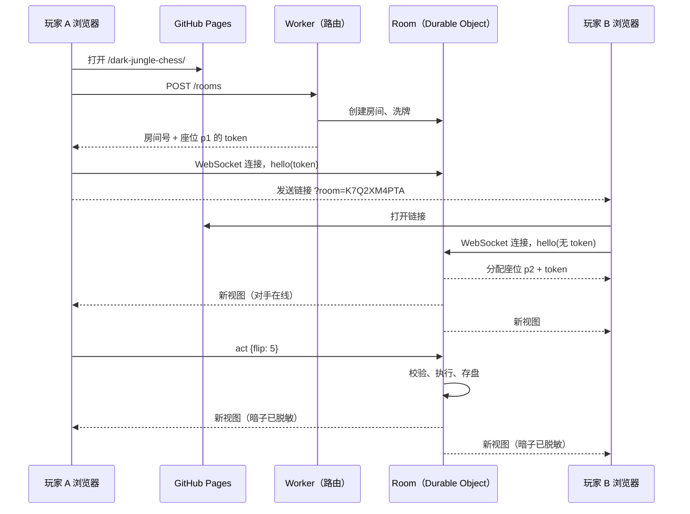

# 暗棋斗兽棋 联网对战 设计文档

让两个人在各自的设备上，通过一个邀请链接联网对战暗棋斗兽棋。页面仍由 GitHub Pages 托管；新增一个 Cloudflare Worker + Durable Objects 的小型对局服务器，持有棋盘、校验每一步、只把已翻开的棋子发给玩家。

- 状态：设计中
- 现有单机版：[`dark-jungle-chess.md`](dark-jungle-chess.md)、[`docs/dark-jungle-chess/index.html`](../docs/dark-jungle-chess/index.html)

## 目标与范围

- 邀请制：A 点「和朋友联网对战」得到一个链接，发给 B，B 打开即入座开局。
- 规则与单机版完全一致（定色阶段、吃子、同归于尽、40 步无进展判和）。
- 刷新页面、切后台、短暂断网后能回到原座位继续下。
- 两位玩家各自看自己选的语言（30 种语言照常可用）。
- 单机同屏模式保持不变，仍是默认。
- 不做：账号、昵称、聊天（免去内容审核）、随机匹配、观战、AI、排行榜。随机匹配和观战放到以后。

## 为什么必须有服务器

这是暗棋：背面朝上的棋子是什么是隐藏信息。单机版整副棋盘都在浏览器里（`state.board`、`sessionStorage` 存档），开发者工具一看就知道每个暗子。同屏对战无所谓，联网对战就是作弊。

- 纯点对点（WebRTC / PeerJS）：总得有一方洗牌、持有棋盘，这一方就能看到所有暗子。要防作弊需要「心理扑克」式的承诺-揭示协议，复杂度远超这个游戏。
- 因此由服务器洗牌、持有完整棋盘，发给客户端的视图里暗子只有「暗子」两个字，没有等级和颜色。服务器是唯一可信方，客户端只发「我想翻第 5 格 / 把第 4 格走到第 8 格」这样的意图。

## 架构



- 一个房间 = 一个 Durable Object 实例（以房间号 `idFromName`）。同一房间的所有消息由同一个实例串行处理，天然没有并发竞争。
- 房间状态存在该实例自带的 SQLite 存储里（用 KV 接口 `ctx.storage.put('room', ...)` 存一个 JSON 即可）。
- 用 WebSocket Hibernation API（`ctx.acceptWebSocket`）：没人走棋时实例被换出内存，连接仍保持，不计运行时长费用；收到消息自动唤醒，构造函数重新从存储读状态。每个连接的座位信息用 `serializeAttachment` 挂在连接上。
- 服务器端不用 `setTimeout` / `setInterval`（会阻止休眠）。需要计时的地方都用时间戳在收到请求时判断，只有房间过期用一个 alarm。

## 代码结构

```text
docs/dark-jungle-chess/
  engine.js        新增：纯规则逻辑，浏览器和 Worker 共用
  i18n.js          新增联网相关文案
  index.html       单机模式改用 engine.js；新增联网模式 UI
server/
  wrangler.jsonc   Worker + Durable Object 绑定、SQLite 迁移
  package.json     只有 wrangler 一个开发依赖（仓库里第一个依赖，只在 server/）
  smoke.js         端到端冒烟测试：对运行中的服务器（wrangler dev 或线上）完整下一局
  src/index.js     Worker：路由、Origin 校验、限流、转发到房间
  src/room.js      Durable Object 适配层：连接、休眠、存储、alarm
  src/room-core.js 房间逻辑：座位、协议、脱敏视图（不依赖 Cloudflare，可直接用 node 测）
tests/
  game.test.js     现有测试，改为同时加载 engine.js
  room.test.js     新增：RoomCore 协议与防泄漏测试
```

### engine.js

把 `index.html` 里与 DOM 无关的部分搬出来，做成和 `i18n.js` 同样的经典脚本：

```js
globalThis.DJCEngine = (() => {
  // IDLE_DRAW_LIMIT, COLORS, canCapture, neighbors, legalTargets, hasHidden, hasLegalAction, aliveCount,
  // newGame(rng), apply(state, seat, action)
  return Object.freeze({ ... });
})();
```

- 浏览器用 `<script src="engine.js?v=<哈希>">` 加载（`tools/csp.js` 本来就给所有同源脚本加版本号，不用改）。Worker 里 `import '../../docs/dark-jungle-chess/engine.js'` 后取 `globalThis.DJCEngine`，由 wrangler 打包。一份代码，两边规则不可能不一致。
- `apply(state, seat, action)` 是唯一的状态迁移入口：`action` 为 `{ flip: i }` 或 `{ move: [from, to] }`，返回 `{ ok: true }` 或 `{ ok: false, err: '<消息键>' }`（`notYourTurn`、`illegalMove`、`badAction`、`gameOver`），被拒的动作不改变状态。单机模式调用 `apply(state, state.current, action)`。
- `newGame(rng)` 的洗牌接受随机数函数：浏览器用 `Math.random`（测试里换成带种子的），服务器用 `crypto.getRandomValues`。
- 选中格 `selected` 和翻转动画 `lastFlipped` 是纯界面状态，移出规则状态。
- 不放进 engine 的：脱敏视图 `viewFor` 属于房间逻辑，放在 `server/src/room-core.js`；存档校验 `isValidSave` 要对照 i18n 的消息键，留在页面里。
- 这一步不改变任何行为，现有 27 个测试应原样通过。

## 协议（WebSocket，JSON 文本帧）

每条消息不超过 1 KB；字段多一个少一个都拒绝。

客户端 → 服务器：

| 消息 | 说明 |
| --- | --- |
| `{"t":"hello","v":1,"token":"..."\|null}` | 连接后 10 秒内必须发送的第一条。带 token 回到原座位；不带则领取空座位。 |
| `{"t":"act","n":12,"a":{"flip":5}}` | 走一步。`n` 是客户端看到的状态版本号，与服务器不一致就拒绝（防止重连后重复提交）。 |
| `{"t":"act","n":12,"a":{"move":[4,8]}}` | 移动或吃子。 |
| `{"t":"resign"}` | 认输。 |
| `{"t":"claim"}` | 对手离线超过 5 分钟且轮到对手时，申请判胜。 |
| `{"t":"rematch"}` | 结束后申请再来一局；双方都申请才开新局，并交换 Player 1 / Player 2，让另一方先翻。 |
| `ping` | 保活，客户端每 20 秒发一次。由 `setWebSocketAutoResponse` 直接回 `pong`，不唤醒实例。 |

服务器 → 客户端：

| 消息 | 说明 |
| --- | --- |
| `{"t":"welcome","seat":"p2","token":"..."}` | 领到座位时下发一次 token。 |
| `{"t":"state","n":13,"you":"p1","seated":{...},"online":{...},"rematch":{...},"last":{"flip":5},"view":{...}}` | 每次状态或在线状态变化都发完整视图（16 格，很小），不做增量，客户端逻辑最简单。`seated` 表示座位是否有人认领，`rematch` 表示谁已申请再来一局，`last` 是上一步动作（`{flip}` 或 `{move}`，用于动画）。 |
| `{"t":"err","k":"notYourTurn"}` | `k` 是 i18n 消息键，客户端按自己的语言显示：`notYourTurn`、`illegalMove`、`badAction`、`gameOver`（来自 engine），以及 `stale`、`waiting`、`badMessage`、`badToken`、`roomFull`、`cannotClaim`、`notOver`。 |

视图（`viewFor`）：

```js
{
  phase, current, players, round, idleSteps, winner,
  board: [ null | { hidden: true } | { rank, color }, ... ],   // 暗子没有 rank / color
  captured: { red: [...], black: [...] },                        // 被吃的子都已翻开
  message: [{ k, p }], overReason: [{ k, p }],                   // 与单机版同一套消息键，另加 resigned、abandoned
}
```

消息仍是 `{k: 键, p: 参数}`，由每个客户端用自己的语言渲染：A 看中文、B 看 Español，互不影响。现有消息的参数只会引用已翻开的棋子，不会泄露暗子。

## 房间生命周期

- 房间号：10 位 Crockford Base32（约 50 位随机数，`crypto.getRandomValues` 生成），不可猜。链接形如 `https://acgtun.com/dark-jungle-chess/?room=K7Q2XM4PTA`。没有列出房间的接口。
- 创建：`POST /rooms` 返回 `{ room, token }`，创建者直接拿到 p1 的 token，避免「拿到链接的人抢先入座 p1」。
- 加入：第一个不带 token 的连接领取 p2；座位满了返回 `roomFull`。
- 座位 token：128 位随机数，房间只存其 SHA-256。客户端存在 `localStorage`（键 `dark-jungle-chess-online`，按房间号存，超过 24 小时清理），关掉标签页再打开链接也能回到座位。
- 同一座位的新连接会顶掉旧连接（旧连接收到关闭码 4001），避免两个标签页同时操作。
- 在线状态：由当前连接的 attachment 算出，连接断开（`webSocketClose`）时通知对手。手机断网时连接常常不会及时关闭，所以还要看 `getWebSocketAutoResponseTimestamp`：超过 60 秒没有 `ping` 的座位按离线算。
- 弃局：对手离线超过 5 分钟且轮到对手，等待方可以 `claim` 判胜。服务器收到请求时比较时间戳，不需要定时器。
- 过期：每次有动作就把 alarm 推迟到 24 小时后；alarm 触发时 `deleteAll()` 清空存储并关闭连接。
- 再来一局：同一房间、同一对 token，交换 Player 1 / Player 2。

## 断线与重连

- 客户端断线后指数退避重连（1、2、4……最多 30 秒），重连后发 `hello(token)`，服务器回完整视图，客户端整页重绘。不需要客户端存对局。
- 手机切到后台再回来：`visibilitychange` 时检查连接，必要时立即重连。
- 带 `?room=` 打开页面就进入联网模式；联网模式不写单机存档 `dark-jungle-chess-game-v1`，两种模式互不覆盖。

## 安全

- 防泄漏是第一位：服务器发出的每一条消息都经过 `viewFor`，测试对随机对局里的每一条外发消息做扫描，暗子不能带 `rank` / `color`。
- 所有客户端输入都不可信：严格校验消息结构和取值范围，校验当前座位、轮次、版本号，非法就回 `err`，规则判断全部在服务器。
- WebSocket 升级请求校验 `Origin`：只接受 `https://acgtun.com`、`https://www.acgtun.com`（本地开发时加上 `http://127.0.0.1:8000`），防跨站 WebSocket 劫持。`POST /rooms` 的 CORS 也只放行这两个来源。
- 限流：每个连接每秒最多 10 条消息，超限关闭（1008）；用 Workers 的 Rate Limiting 绑定按 IP 限速：创建房间每分钟 10 个，WebSocket 连接每分钟 60 个（该绑定只支持 10 秒或 60 秒的周期，且按 Cloudflare 机房分别计数，是近似限制）。
- 每个房间只有 2 个座位，第三个人入座被拒（`roomFull`）；同座位的新连接顶掉旧连接。每个房间最多同时 6 个连接（含还没发 `hello` 的），没在 10 秒内发 `hello` 的连接会被断开。
- 不收集个人信息：没有账号、昵称、聊天。房间数据 24 小时后删除。
- 服务器地址写在页面的 `<meta name="online-server" id="online-server" content="...">` 里，为空时不显示联网入口（部署前就是这样，合并客户端代码不影响线上）。页面本身从 `127.0.0.1` 打开时改连本地的 `wrangler dev`（`http://127.0.0.1:8787`）。
- 页面 CSP 增加 `connect-src`：只放行这两个地址（各自的 `https`/`wss` 或 `http`/`ws`）；其余（Trusted Types、无 `innerHTML`、脚本哈希）不变。`tools/csp.js` 从上面的 meta 读地址生成。
- Worker 的响应带 `X-Content-Type-Options: nosniff` 等安全头；错误信息不回显内部细节。

## 界面

- 单机界面加一个「和朋友联网对战」按钮：创建房间 → 显示邀请链接、「复制链接」按钮，手机上用 `navigator.share` 调出系统分享。
- 等待对手时显示「等待对手加入…」；对手入座后自动开始定色阶段。
- 玩家徽章上标出「你」，对手离线时显示离线提示和（5 分钟后）「判我胜」按钮。
- 只有轮到自己时棋盘可点；选中、高亮、键盘操作、读屏标签都沿用单机版。
- 结束画面：「再来一局」变成向对手发出再战邀请，「退出」回到单机模式。
- 服务器不可用（含免费额度用完）时显示「联网对战暂时不可用」，并提供单机模式入口。
- 新增约 15 条文案，30 种语言都要补齐，沿用现有测试（键、占位符一致，无残留）。

## 部署与费用

- Cloudflare 免费账户即可：免费计划支持 Durable Objects（仅 SQLite 存储后端），每天 10 万次请求、13,000 GB-s 运行时长、5 GB 存储。收到的 WebSocket 消息按 20:1 折算请求数。
- 估算：一局约 1 次创建 + 2 次连接 + 100 多条走棋消息（折算约 6 次）≈ 10 次请求，免费额度够每天约一万局。休眠期间不计运行时长。
- 超出免费额度当天的请求会直接失败，次日 00:00 UTC 重置；客户端按「暂时不可用」处理。
- 部署：在 `server/` 下 `npx wrangler deploy`。之后可以加 GitHub Actions，用仓库 secret 里的 Cloudflare API token 自动部署。
- 服务器地址见下方已定决策。

## 测试

- `node tests/game.test.js`：现有规则与界面测试，改为加载 `engine.js`。
- `node tests/room.test.js`（无依赖，直接测 RoomCore）：
  - 每次运行 400 局随机对局（随机种子，失败时打印种子以便重现），双方客户端各自随机走合法步，每条外发消息都不含暗子信息。
  - 不是自己的回合、非法移动、版本号过期、结构不对的消息都被拒绝且状态不变。
  - 第三个连接被拒；同座位新连接顶掉旧连接；带 token 重连回到原座位，错误 token 被拒。
  - 再来一局交换先后手；弃局判胜只在对手离线满 5 分钟且轮到对手时成立；过期后房间清空。
- 服务器冒烟测试：`server/` 下 `npm run dev` 起本地服务器，另开终端 `npm run smoke`（或 `node smoke.js <线上地址>`）。检查 Origin 校验、完整一局、第三人被拒、过期版本号、ping/pong、再来一局交换座位、认输、带 token 重连。
- 端到端：`wrangler dev` 起本地服务器，两个无头 Chrome 页面通过 CDP 完整下一局，检查无 CSP 报错、双方画面一致。

## 实现步骤

每一步一个 PR。

| 步骤 | 内容 | 状态 |
| --- | --- | --- |
| engine | 抽出 `engine.js`，单机版改用它，行为不变 | 已完成 |
| room-core | RoomCore：座位、协议、脱敏视图、`room.test.js` | 已完成 |
| server | Durable Object 适配、Worker 路由、Origin 校验、限流、`wrangler dev` | 已完成 |
| client | 联网模式界面、重连、CSP `connect-src`、30 种语言文案 | 已完成 |
| deploy | Cloudflare 账户、服务器地址、线上冒烟测试 | 待开始 |
| polish | 弃局判胜、再来一局、系统分享；以后再考虑随机匹配、观战 | 待开始 |

## 已定决策

1. 服务器地址：先用 `djc.<账户子域>.workers.dev`，不动 DNS。Cloudflare 建议正式服务用自定义域名，个人项目可以接受。
   - 以后要换成 `api.acgtun.com`：Workers 自定义域名要求域名在 Cloudflare 上解析。`acgtun.com` 现在的 DNS 在 GoDaddy（`domaincontrol.com`），要把域名服务器改到 Cloudflare（注册商不用换），并在 Cloudflare 里重建指向 GitHub Pages 的 4 条 A 记录和 `www`（设为「仅 DNS」，否则 GitHub 的 HTTPS 证书续期会出问题）。页面这边只改 CSP 和一个常量。
2. Player 1：房间创建者是 Player 1（与单机一致），每次再来一局交换。
3. 回合计时：v1 不做，只做对手离线 5 分钟可判胜。
