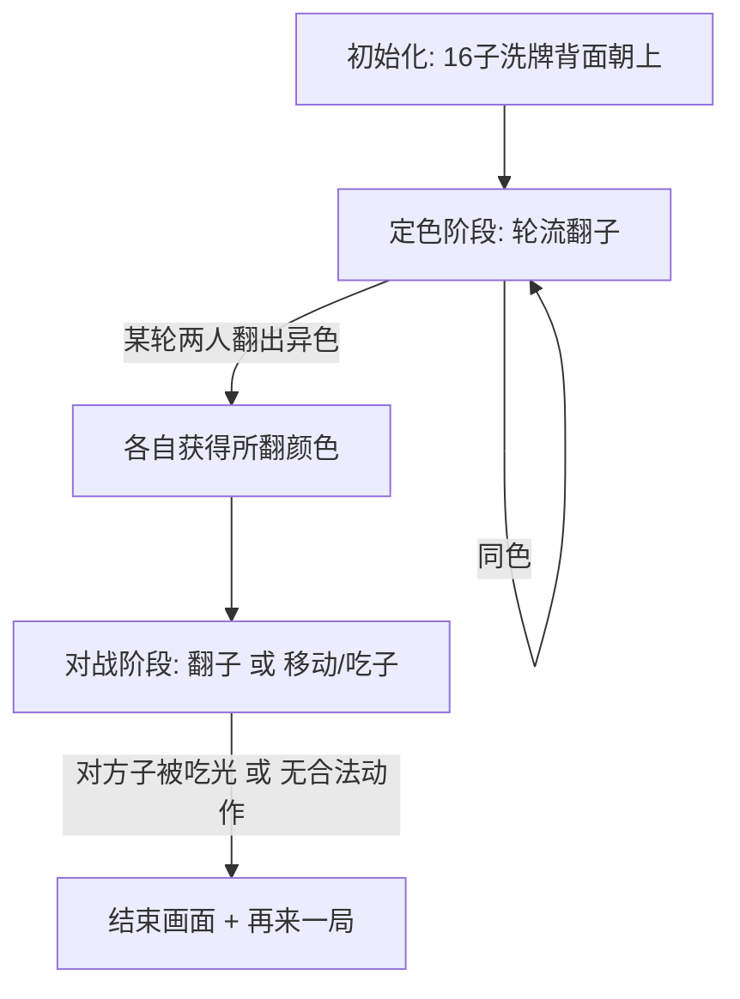

# 暗棋斗兽棋（Dark Jungle Chess）网页游戏 设计文档

用单个 HTML 文件（纯 HTML/CSS/JS）实现一个 4x4 暗棋版斗兽棋，双人同屏轮流操作，含翻子定色阶段、吃子等级规则、同归于尽和胜负判定。

- 状态：已实现，待发布到 <https://acgtun.com/dark-jungle-chess/>
- 代码：[`docs/dark-jungle-chess/index.html`](../docs/dark-jungle-chess/index.html)

## 目标与范围

- 单文件游戏（内嵌 CSS/JS），无任何依赖，浏览器直接打开即玩。
- 通过 GitHub Pages 托管：`docs/` 为站点根目录，`docs/CNAME` 绑定 `acgtun.com`，`docs/.nojekyll` 关闭 Jekyll 处理，`docs/index.html` 为入口页。
- 双人同屏（hot-seat）。不做 AI，不做联网。

## 规则

- 4x4 = 16 格，开局摆满 16 个棋子（红黑各 8），全部背面朝上、随机洗牌。
- 等级：1 网、2 象、3 狮、4 虎、5 狼、6 羊、7 猫、8 鼠。
- 吃子：
  - 1 吃 2–7（吃不了 8）。
  - 2–7 各吃比自己数字大的所有子。
  - 8 只吃 1。
- 同级相遇：主动撞上时同归于尽，双方都移出棋盘，目标格变空。
- 定色阶段：两位玩家轮流各翻一个暗子为一轮。某一轮两人翻出的颜色不同时，各自获得所翻颜色，进入对战阶段；若同色则继续下一轮翻子。
- 对战阶段每回合二选一：
  - 翻开一个暗子；或
  - 移动/吃子：己方明子走一格（上下左右），只能吃已翻开的对方棋子。
- 胜负：
  - 对方棋子被吃光获胜。
  - 轮到某方时无合法动作（无暗子可翻且无子可动）判负。
  - 双方合计连续 40 步无翻子且无吃子判和（防止残局无限追逐）；双方最后的棋子同归于尽也判和。

### 细节约定

- 定色阶段翻出的子留在棋盘上正面朝上，进入对战阶段后正常参战。
- 定色结束后由 Player 1 先行动。
- 移动只能走到空格；同归于尽算一次合法吃子动作（双方子都进被吃区）。
- 已选中己方棋子时，点非目标格只取消选中（点另一个己方明子则改选），不会翻子，避免误触白白用掉回合。
- 对局进行中点「重新开局」需要确认；结束画面的「再来一局」不需要。

## 数据模型

```js
// board: 长度 16 的数组，元素为 null（空格）或棋子对象
{ rank: 1..8, color: 'red'|'black', revealed: false }

state = {
  phase: 'assign' | 'play' | 'over',
  board: [...],
  players: { p1: null|'red'|'black', p2: ... },  // assign 阶段结束后填充
  current: 'p1' | 'p2',
  round: 1,              // 定色阶段第几轮
  roundFlips: [],        // assign 阶段本轮两次翻子的颜色
  selected: null,        // 当前选中的己方棋子下标
  captured: { red: [], black: [] },
  idleSteps: 0,          // 双方合计连续无翻子且无吃子的步数，达到 40 判和
  lastFlipped: null,     // 刚翻开的格子下标，只用于播放一次翻转动画
  winner: undefined,     // 'p1' | 'p2' | null（平局）
  overReason: [],        // 结算原因，消息 parts
  message: [],           // 状态栏消息 parts：{ k: 消息键, p: 参数 }，渲染时按当前语言翻译
}
```

`state` 每次渲染后存入 `sessionStorage`（键 `dark-jungle-chess-game-v1`），刷新页面或去规则页再回来都会恢复对局。结构变化时改键的版本号，旧存档会被忽略。

存档是不可信输入：`loadGame` 用 `isValidSave` 逐字段校验（阶段枚举、16 格棋子、棋子总数 16、消息键必须在 I18N 里且参数类型正确等），任何一项不符就丢弃，开一局新的。渲染出错也回退到新局，坏存档不会让页面卡死。

吃子判定为纯函数，便于自测：

```js
function canCapture(a, b) {
  if (a === b) return 'mutual';           // 同归于尽
  if (a === 8) return b === 1;            // 鼠只吃网
  if (a === 1) return b >= 2 && b <= 7;   // 网吃不了鼠
  return b > a;
}
```

## 游戏流程



## UI 设计

- 居中 4x4 棋盘；暗子显示为统一背面卡牌，点击翻开时有 CSS 3D 翻转动画。
- 明子显示：颜色（红/黑底）+ 动物 emoji + 数字等级 + 当前语言的动物名（如「3 狮」）。
- 对战阶段：点击己方明子高亮选中，同时高亮可走/可吃的目标格；再点目标格执行。
- 顶部状态栏：当前轮到谁（Player 1 / Player 2 及其颜色）、阶段提示（如「定色阶段：请 Player 2 翻一个子」）。
- 两侧被吃区：分别显示红黑双方已阵亡棋子。
- 结束时显示胜者遮罩层 +「再来一局」按钮（重新洗牌）。
- 顶栏：左侧「📖 玩法说明」链接到独立的规则页 `rules.html`（棋子等级、吃子规则、定色、对战、胜负），右侧「🌐 + 语言下拉框」，30 种语言各用本语言书写，简体中文和 English 排在最前。玩家打开过规则页之前，链接高亮显示为「新手？先看玩法说明」。规则页的语言设置与游戏共用。
- 规则页里的步数上限与游戏各写一份，测试会校验两边一致。
- 无障碍：格子可用 Tab 聚焦，方向键移动、回车/空格操作；每格有读屏标签（位置、棋子、是否选中/可走/可吃）；状态栏为 `aria-live`；结束画面为对话框并自动聚焦「再来一局」。
- 页面带 meta description、Open Graph 标签与 emoji favicon，分享链接时有标题和简介。

## 多语言

- 30 种语言（按使用人数）：简体中文、English、हिन्दी、Español、العربية、Français、বাংলা、Português、Русский、Bahasa Indonesia、اردو、Deutsch、日本語、Naijá、मराठी、తెలుగు、Türkçe、Hausa、தமிழ்、Kiswahili、繁體中文、Tiếng Việt、Filipino、한국어、فارسی、Basa Jawa、Italiano、ਪੰਜਾਬੀ、ไทย、ગુજરાતી。译文由 AI 生成，未经母语者校对。
- 文案集中在 `docs/dark-jungle-chess/i18n.js`，游戏页、规则页、首页共用。只有纯字符串：`{占位符}` 由 `DJC.fmt` 替换，`**粗体**` 由规则页转成 `<b>`，始终以文本写入 DOM。每种语言的键、占位符、`**` 数量必须与英文一致（测试校验）。
- 措辞：颜色只作形容词修饰"棋子 / 方 / 阵营"（"Captured black pieces"、"黑方"），不单独当群体名词与"被吃 / 阵亡"等词连用，避免读成指人群。
- 语言选择顺序：localStorage 里保存的选择 → 浏览器 `navigator.languages` 中第一个支持的语言（zh-TW/HK/MO/Hant → 繁體中文，tl → Filipino）→ 简体中文。
- 阿拉伯语、乌尔都语、波斯语把 `<html dir>` 设为 `rtl`，整页镜像；棋盘固定 `direction: ltr`，保证「第几行第几列」的读屏标签与画面一致。
- 中日文（`body.cjk`）句子之间不加空格、用较宽字距；被吃区小卡片只有中日文显示动物名，其他语言显示等级数字。

## 安全

- 不用 `innerHTML` 等 HTML 字符串接口，所有文本经 `textContent` / `createElement` 写入 DOM（测试会扫描页面）。
- 每个页面带 `<meta>` CSP：`default-src 'none'`，内联 `<script>` / `<style>` 只放行其 sha256 哈希，外部脚本只放行同源（`'self'`，即 `i18n.js`），并开启 Trusted Types（`require-trusted-types-for 'script'; trusted-types 'none'`），即使将来误用 HTML 字符串接口也会被浏览器拒绝。
- 改了任何页面的内联脚本或样式、或 `i18n.js` 后运行 `node tools/csp.js`：重算 CSP 哈希，并把外部脚本地址写成 `i18n.js?v=<内容哈希>`（GitHub Pages 对所有文件缓存 10 分钟，带版本号才不会出现新页面配旧脚本）。测试会校验两者是否最新。
- `<meta>` CSP 不支持 `frame-ancestors` 和上报；GitHub Pages 不能设响应头，这两项接受缺失。

## 实现步骤

| 步骤 | 内容 | 状态 |
| --- | --- | --- |
| skeleton | 棋盘布局 + 卡牌/翻转/高亮 CSS | 已完成 |
| core-logic | 洗牌、`canCapture`、合法动作枚举、同归于尽 | 已完成 |
| assign-phase | 定色阶段状态机（轮流翻子、异色定角色） | 已完成 |
| play-phase | 对战回合循环 + 胜负判定 | 已完成 |
| ui-polish | 状态栏、被吃区、结束画面、重开按钮 | 已完成 |
| verify | 完整对局自测边界规则 | 已完成 |

## 测试

`node tests/game.test.js`，无依赖。测试直接执行页面里的 `<script>`（用最小的假 DOM），覆盖：

- `canCapture` 全部 8×8 组合；8 吃 1、1 不能吃 8。
- 同级同归于尽，双方进被吃区，目标格变空；最后的子同归于尽判和。
- 吃光对方获胜；轮到某方无合法动作判负；达到无进展步数上限判和。
- 选中棋子后点暗子只取消选中、不翻子、不换手。
- 定色阶段异色定角色后由 Player 1 先行动。
- 对局存档能恢复；被篡改（如消息参数里塞 HTML）或损坏的存档被拒绝，页面回退到新局。
- 页面不含 HTML 字符串接口；CSP 哈希与内联脚本/样式一致。
- 规则页与游戏的步数上限一致，两页互相链接。
- 30 种语言的结构与英文一致；每种语言渲染游戏、全部消息和规则页都没有残留的占位符或 `**`；语言自动选择规则；RTL 语言切换 `dir`。
- 3000 局随机对局：棋子总数守恒、每步换手、每步存档都能通过校验并读回、对局必然结束。随机数带种子，失败时用输出里的 `SEED=<n> node tests/game.test.js` 复现。
